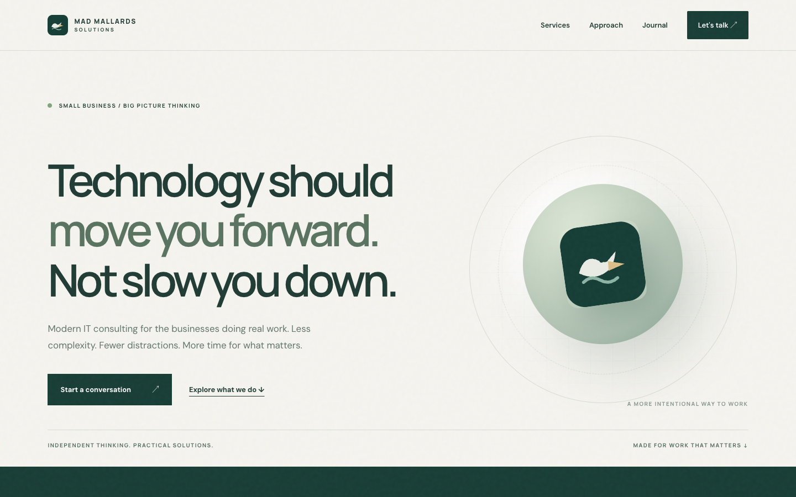

# Mad Mallards Solutions

[](Dockerfile)
[](site/app.js)
[](compose.yml)
[](server.py)

[](https://github.com/drakeg/mad-mallards-solutions/actions/workflows/ci.yml)
[](LICENSE)
[](https://github.com/drakeg/mad-mallards-solutions/issues)
[](https://github.com/drakeg/mad-mallards-solutions/pulls)



Premium minimal IT consulting website for SMBs, powered by the original Scroll Craft engine, a standard-library Python backend and SQLite.

## Preview

The screenshots were captured from the running local site with headless Chrome. Desktop shown above; [mobile preview](docs/images/home-mobile.png).

## Run locally
From the repository root:

```bash
python3 server.py
# http://127.0.0.1:8099
```

Docker Compose is supported:

```bash
docker compose up --build -d
# http://localhost:8099
```

Change the host port using `MMS_PORT=8098 docker compose up --build -d`. Docker binds to the LAN by default, so use network access controls and **do not expose the prototype publicly**. SQLite data persists in the `madmallards_data` named volume.

## Features
- Distinct restrained Scroll Craft scrolling scenes; editorial layout and mobile breakpoint
- Four consulting services and an interactive friction comparison
- Three original journal articles
- Contact form and newsletter interest signup with server-side SQLite storage
- Rate limiting, basic input validation and honeypot anti-spam
- Basic security response headers and reduced-motion support

**Important:** The contact form records leads but does not yet send emails. Newsletter signups are stored as `pending`; no marketing emails or double opt-in are sent. Treat the website as a local prototype until security/privacy review, email provider, domain and TLS configuration are complete.

## Tests
```bash
python3 -m unittest discover -s tests -v
```

## Upstream design skill
The untouched `site/scrollcraft.js` and `site/scrollcraft.css` are copied from the MIT-licensed [nateherkai/scroll-craft](https://github.com/nateherkai/scroll-craft), imported from the installed source snapshot at commit `75d81f7`. Original engine license attribution appears in [LICENSE](LICENSE). Original bespoke styling belongs in `site/styles.css`.

## Local data
`data/leads.sqlite3` stays out of Git. Access it with an authorized local SQLite client. Avoid sharing customer data in screenshots or public issue reports. Back up the volume before upgrades.

## Project process
See [AGENTS.md](AGENTS.md), [SPRINTS.md](SPRINTS.md), [BACKLOG.md](BACKLOG.md), [CONTRIBUTING.md](CONTRIBUTING.md) and [RELEASES.md](RELEASES.md).

## Browser and accessibility checks

Run the local server, then:

```bash
npm ci
npm run test:browser
npm run test:a11y
```

The scripts use installed Chrome on macOS or Playwright Chromium on other platforms; override with `SCROLLCRAFT_CHROME`. GitHub CI installs the free Playwright Chromium runtime.

## Viewing locally stored leads

Only authorized operators with shell access can view or change submissions. The commands below run inside the persistent Docker container:

```bash
docker compose exec -T web python scripts/manage_leads.py summary
docker compose exec -T web python scripts/manage_leads.py contacts
docker compose exec -T web python scripts/manage_leads.py subscribers
docker compose exec -T web python scripts/manage_leads.py export-contacts > contacts.csv
docker compose exec -T web python scripts/manage_leads.py export-subscribers > subscribers.csv
```

CSV exports contain personal information and must not be committed, publicly shared, or left on a shared device. The exporter neutralizes spreadsheet formula injection. To unsubscribe a specific address:

```bash
docker compose exec -T web python scripts/manage_leads.py unsubscribe person@example.com --confirm
```

To delete specific records use `delete-contact <numeric-id> --confirm` or `delete-subscriber <numeric-id> --confirm`. Back up data before deletion. The system does not send email and does not mark a pending subscription as confirmed.
